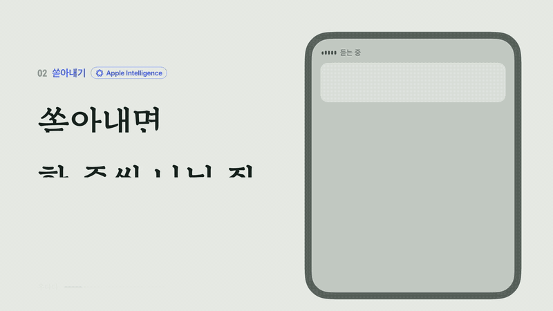

# 우다다 (Udada)

머릿속이 시끄러울 때 쓰는 플래너. 떠오르는 걸 쏟아내면 한 줄씩 나눠 주고, 하루는 아침·낮·저녁 세 칸으로만 봅니다.
iPhone · Mac 용 SwiftUI 앱이고, AI 는 전부 기기 안의 Apple Intelligence(Foundation Models)로만 돕니다.

A calm day planner for iPhone and Mac, written in SwiftUI. Dump what is on your mind and it is split into single lines and sorted; the day is just three bands. All AI runs on device with Apple Intelligence (Foundation Models) — no server, no account, no tracking. The UI is Korean only.



- **App Store (안정판, 무료):** https://apps.apple.com/kr/app/id6831147747
- **소개 영상 (90초, 1080p · 4K):** [nightly 릴리스](https://github.com/bunhine0452/udada/releases/tag/nightly)의 `udada-intro-*.mp4`
- **Mac nightly 빌드:** 같은 [nightly 릴리스](https://github.com/bunhine0452/udada/releases/tag/nightly)

## 무엇을 하나

| | |
|---|---|
| 하루 한 장 | 아침 · 낮 · 저녁 세 칸. 약속은 시각에 박히고 할 일은 칸 안에 떠 있다. 지금 줄이 "치과까지 40분, '메일 답장' 15분이 들어가"처럼 말해 준다. |
| 한 줄로 넣기 | "내일 3시 치과" → 날짜·시각·길이를 읽어 넣기 전에 보여 준다. 한 줄에 일이 여럿이면 나눠서 넣는다. |
| 쏟아내기 | 쓰기 · 말 · 사진. 한 줄씩 떼어 지금 · 날짜 · 걱정 · 버리기로 나눈다. 넣는 건 사용자가 누른다. |
| 말로 하기 | "다음 주에 병원 언제야", "치과 내일로 미루고 보고서는 끝냈어". 바꾸기 전에 먼저 보여 준다. |
| Siri | "우다다한테 시키기", "우다다로 정리해 줘" — 앱을 열지 않고 여러 일을 바꾸고 결과를 보여 준다. |
| 밖에서 받기 | 메시지 · 메일 · 포스터 사진을 공유하면 챙길 약속만 고른다. |
| 식히기 · 하루 닫기 | 1분 숨, 걱정 상자와 하루 10분 걱정 시간, 「오늘 끝」 도장. |
| 시스템 | 위젯, 잠금 화면 실시간 현황, 제어 센터, Spotlight, 집중 모드 필터, iPhone ↔ Mac 이어 쓰기(내 iCloud). |

## AI 를 쓰는 방식

- **기기 안에서만.** 모델 호출은 `SystemLanguageModel` 뿐이다. 개발자 서버로 가는 네트워크 호출, 계정, 분석, 광고가 없다.
- **모델은 "흐트러진 말을 알아듣는 일"에만.** 날짜 · 개수 · 찾기 같은 사실은 규칙이 실제 기록으로 답한다. 모델이 지어낸 줄은 검사에서 버린다.
- **없어도 돈다.** Apple Intelligence 를 지원하지 않거나 꺼 둔 기기에서는 같은 흐름이 규칙(`BrainFallback.swift`)으로 돈다.
- 위기 낱말이 든 글은 어떤 모델 호출보다 먼저 걸러 상담 전화만 안내한다.

어디에 쓰고 어디에 안 쓰는지, 프롬프트를 어떻게 고쳤는지, 실제 모델로 잰 숫자는 [`udada/design/AI.md`](udada/design/AI.md)에 있습니다.
창구는 [`Brain.swift`](udada/ios/Udada/AI/Brain.swift), 모델에 닿는 유일한 파일은 [`BrainPrompts.swift`](udada/ios/Udada/AI/BrainPrompts.swift)입니다.

## 폴더

```
udada/ios/        앱 (xcodegen 프로젝트)
  Shared/           모델 · 하루 계산 · 한 줄 읽기 · 색과 글꼴 (앱 · 위젯 · Mac 공용)
  Udada/            iPhone 앱 — AI/ 가 Apple Intelligence 와 움직이는 사용법
  UdadaMac/         Mac 앱 (메뉴 막대 + 하루 창)
  UdadaWidgets/     위젯 · 실시간 현황 · 제어 센터
  UdadaShare/       공유 확장
  Eval/             실제 기기 안 모델로 재는 평가 묶음과 채점기
udada/design/     설계 글 (AI.md · DAY.md · VALUE.md · RESEARCH.md)과 초기 웹 시안
udada/appstore/   스토어 글 · 스크린샷 · 스크린샷을 다시 찍는 도구
udada/film/       소개 영상 렌더러
.oculpm/          작업 일지와 계획 (어떤 결정을 왜 했는지)
```

## 빌드

Xcode 27 과 [xcodegen](https://github.com/yonaskolb/XcodeGen)이 필요합니다. iPhone 은 iOS 18 이상, Mac 은 macOS 26 이상을 대상으로 합니다.

```sh
brew install xcodegen
cd udada/ios
xcodegen generate
open Udada.xcodeproj        # 스킴: Udada (iPhone) · UdadaMac (Mac)
```

자기 계정으로 기기에 올리려면 `project.yml` 의 `DEVELOPMENT_TEAM` 과 번들 ID 접두사, 그리고 권한 파일(`*.entitlements`)의 앱 그룹 · iCloud 컨테이너 이름을 자기 것으로 바꿔야 합니다. 시뮬레이터에서는 `-udNoSync` 실행 인자를 주면 iCloud 없이 돕니다.

테스트:

```sh
# 규칙 · 맞추기 · 명령 해석 (시뮬레이터 없이 Mac 에서)
xcodebuild test -project Udada.xcodeproj -scheme UdadaMac -destination 'platform=macOS' CODE_SIGNING_ALLOWED=NO
# iPhone 단위 · UI 테스트
xcodebuild test -project Udada.xcodeproj -scheme Udada -destination 'platform=iOS Simulator,name=iPhone 17'
```

확인용 실행 인자: `-udReset -udSeed -udSkipIntro -udNoSync -udNow 2026-11-18T14:20` (예시 하루로 시작), `-udTourPage 3 -udTourAt 6.6` (사용법의 그 장면 · 그 순간에서 멈춤).

## Nightly

`main` 을 그대로 빌드한 Mac 앱을 [nightly 릴리스](https://github.com/bunhine0452/udada/releases/tag/nightly)에 올립니다. 직접 만들려면:

```sh
udada/ios/scripts/nightly.sh            # udada/ios/build/nightly/ 에 zip
```

- iCloud 권한 없이 서명합니다. 기록은 그 Mac 에만 남고, App Store 판과 저장소도 따로입니다(번들 ID `…udada.nightly`).
- 공증(notarization)을 하지 않았습니다. 처음 열 때 시스템 설정 → 개인정보 보호 및 보안에서 "그래도 열기"를 눌러야 합니다.
- iPhone 판은 서명 때문에 nightly 로 배포하지 않습니다. App Store 판을 쓰거나 위 방법으로 직접 빌드하세요.

## 소개 영상은 어떻게 만들었나

앱 안의 "움직이는 사용법" 장면은 시각 `t` 의 순수 함수입니다([`GuideKit.swift`](udada/ios/Udada/AI/GuideKit.swift)). 그래서 화면을 녹화하지 않고, 같은 SwiftUI 코드를 프레임마다 그려 ffmpeg 로 흘려보냅니다.

```sh
brew install ffmpeg
udada/film/render.sh           # udada/film/out/ 에 1080p60 mp4 와 미리보기 gif  (UHD=1 이면 4K 도)
```

## 라이선스

코드는 [MIT](LICENSE). 글꼴 고운바탕(Gowun Batang)은 [SIL Open Font License](udada/ios/Udada/Resources/Fonts/OFL.txt)를 따릅니다.
"우다다" 이름과 앱 아이콘으로 같은 앱인 것처럼 스토어에 올리지는 말아 주세요.
