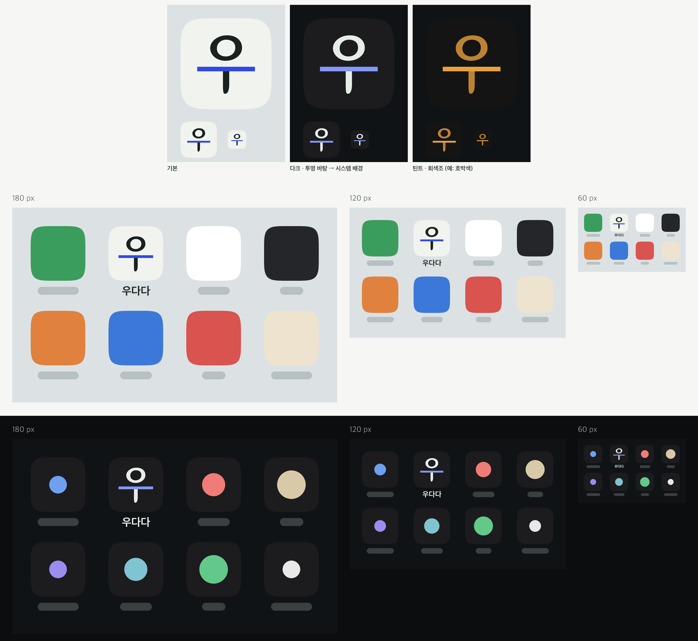
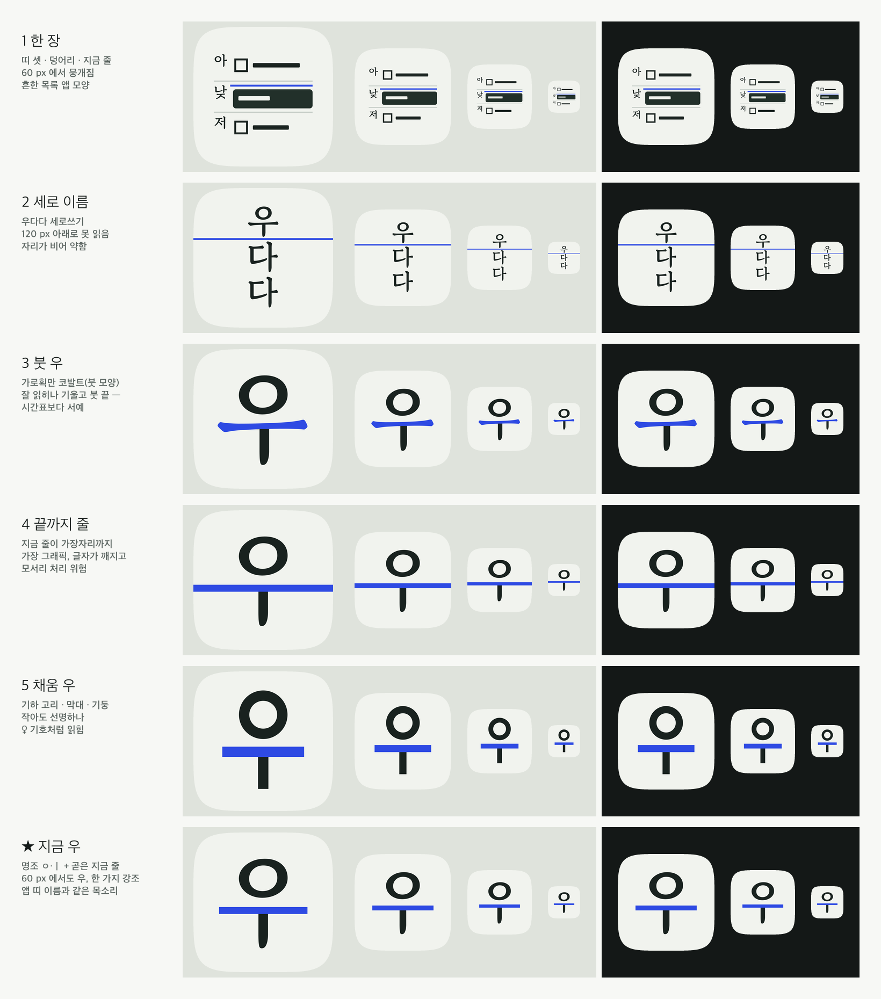
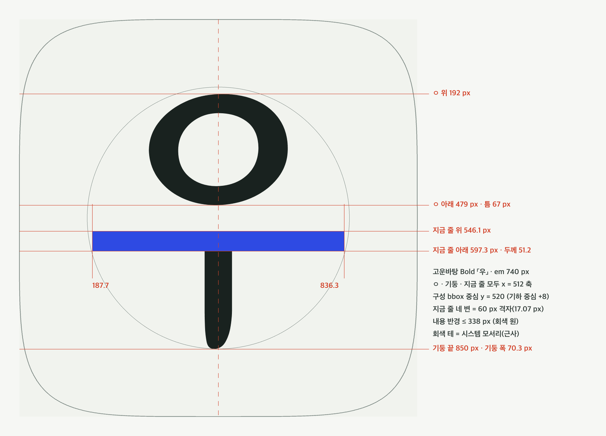
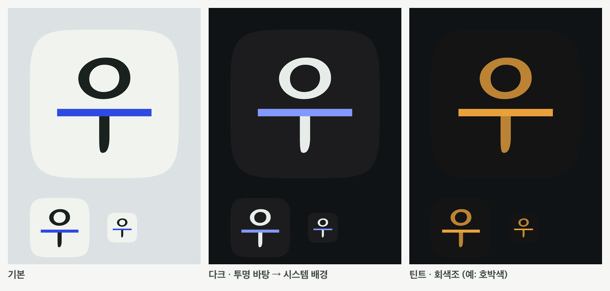

# 우다다 앱 아이콘: 「지금 우」



## 개념

- 이름의 첫 글자 「우」를 앱의 띠 이름(아침·낮·저녁)과 같은 부드러운 명조, **고운바탕 Bold**로 쓴다. 가로획 ㅡ 하나만 곧은 **코발트 지금 줄**로 바꿨다.
- 「우」는 ㅇ, 가로획, 기둥이 위에서 아래로 쌓인 글자다. 가운데 가로획이 놓인 자리는 하루 한 장을 가로지르는 지금 줄의 자리와 같다. 그래서 글자 하나가 이름(우다다)과 하는 일(지금)을 함께 말한다.
- 색은 종이 바탕, 먹, 코발트 하나뿐이다. 앱의 규칙(강조는 코발트 하나, 그라데이션·그림자·광택 없음)을 아이콘에도 그대로 지킨다.
- 붓으로 쓴 ㅇ·ㅣ 위에 자로 그은 줄 하나가 놓인다. 이것이 「차분한 종이 시간표」다. 사람의 글씨 위에 정확한 선이 하나 있다.

## 왜 이것인가: 탐색 5안



| 안 | 60 px | 붐비는 홈 화면 | 앱과의 맞음 | 판정 |
|---|---|---|---|---|
| 1 한 장: 띠 셋·덩어리·지금 줄 축소판 | 뭉개짐 | 흔한 목록·메모 앱처럼 보임 | 화면을 그대로 옮김 | 탈락 |
| 2 세로 이름: 우다다 세로쓰기 | 못 읽음(120 px 아래) | 가늘고 비어서 약함 | 띠 이름과 같은 목소리 | 탈락 |
| 3 붓 우: 붓 가로획만 코발트 | 읽힘 | 개성 있음 | 획이 기울고 붓끝이 있어 시간표보다 서예에 가까움 | 보류 |
| 4 끝까지 줄: 지금 줄이 가장자리까지 | 읽힘 | 가장 그래픽함 | 글자가 깨지고 시스템 테두리 광택과 부딪칠 위험 | 탈락 |
| 5 채움 우: 기하 고리·막대·기둥 | 가장 선명 | ♀ 기호나 사람 픽토그램으로 읽힘 | 명조의 목소리가 없음 | 탈락 |
| **★ 지금 우** | 읽힘(ㅇ 구멍이 열려 있고 줄이 3 px로 또렷) | 원색 이웃 사이에서 조용해서 오히려 눈에 띔 | 띠 이름과 같은 글꼴에 지금 줄 | **채택** |

## 구성 (1024 px 캔버스)



- **글자**: 고운바탕 Bold `우`(U+C6B0, em 740 px). 윤곽 0·2(ㅇ)는 그대로 둔다. 윤곽 1(ㅜ)에서는 기둥 ㅣ만 남기고 붓 ㅡ는 버린다.
- **축**: ㅇ, 기둥, 지금 줄의 중심이 모두 x = 512에 있다. 글꼴 원본은 붓 ㅡ의 무게 때문에 기둥이 ㅇ보다 11 u 오른쪽에 있다. 곧은 줄로 바꾸면서 셋을 한 축에 모았다.
- **지금 줄**: 187.7–836.3 × 546.1–597.3 px(648.5 × 51.2).
  - 네 변이 모두 60 px 격자(1024/60 = 17.07 px) 위에 있다. 그래서 60·120·180 px로 줄여도 줄 끝이 번지지 않는다. actool이 만든 120 px에서 확인했다.
  - 두께 51.2 px(69 u)는 기둥 70.3 px(95 u)보다 가늘다. 명조에서 가로획이 세로획보다 가는 것과 같다.
  - 끝은 각지게 둔다. 둥글리면 알약 모양 버튼처럼 보인다.
- **세로 리듬**: ㅇ 192–479, 틈 67, 줄 51, 기둥 끝 850. 구성 상자의 중심은 y = 520이다. ㅇ이 무거워서 기하 중심보다 8 px 내렸다.
- **안전 영역**: 모든 내용이 중심에서 반경 338 px(캔버스의 33 %) 안에 있다. 모서리는 시스템이 깎으므로 PNG는 네모 그대로 넣는다.
- **작은 크기**: 60 px에서 ㅇ의 가는 쪽 2.9 px, 지금 줄 3.0 px, 기둥 4.1 px. 29 px(설정 목록)에서도 「우」로 읽힌다.

## 색

| 쓰임 | 기본(밝은) | 다크 | 틴트 |
|---|---|---|---|
| 바탕 | 종이 `#F1F3EE` (Ink.ground) | 투명(시스템 배경이 비침) | 투명(시스템 배경이 비침) |
| ㅇ · 기둥 | 먹 `#19221F` (Ink.text) | `#E6EDE9` (Ink.text 어두운) | 회색 `#C8C8C8` (78 %) |
| 지금 줄 | 코발트 `#2E4AE3` (Ink.accent) | `#8399FF` (Ink.accent 어두운) | 흰색 `#FFFFFF` (100 %) |

- 대비: 먹/종이 14.6:1, 코발트/종이 5.9:1, 다크 `#E6EDE9`/`#1C1C1E` 14.3:1, `#8399FF`/`#1C1C1E` 6.5:1.
- 틴트에서는 시스템이 밝기만큼 사용자 색을 입힌다. 그래서 가장 밝은 줄이 기본 아이콘의 코발트 자리, 곧 하나뿐인 강조를 이어받는다.

## 모양새 (iOS 18+)



- `ios/Udada/Assets.xcassets/AppIcon.appiconset`은 Single Size(universal, 1024 × 1024) 세 장이다.
  - 기본 `AppIcon-1024.png`: RGB, 알파 없음
  - 다크 `AppIcon-1024-dark.png`: `luminosity: dark`, 투명 바탕
  - 틴트 `AppIcon-1024-tinted.png`: `luminosity: tinted`, 회색조, 투명 바탕
- Apple 지침(Xcode 문서 *Configuring your app icon*): "Provide your dark app icon with a transparent background so the system-provided background can show through." / "Provide your tinted app icon as a grayscale image."
- 바탕이 단색이고 앞 모양이 크고 단순하다. 그래서 iOS 26이 비트맵 아이콘을 배경과 전경으로 나눠 Liquid Glass를 입힐 때도 잘 맞는다. clear 모양새는 시스템이 자동으로 만든다.
- 미리보기에서 다크 배경은 평면 `#1C1C1E` 근사이고, 틴트는 호박색 예시다. 실제 시스템 배경과 광택은 OS 버전마다 다르다.

## 홈 화면 미리보기

- [`home-light.png`](home-light.png): 밝은 배경화면, 180 / 120 / 60 px, 단색 이웃 아이콘 사이
- [`home-dark.png`](home-dark.png): 어두운 배경화면, 다크 모양새, 같은 크기

## 하지 말 것

- 그라데이션, 빛 번짐, 그림자, 3D, 유리 질감, 종이 질감을 넣지 않는다.
- 지금 줄의 색을 바꾸지 않는다. 주홍·박하·검정은 안 된다. 코발트는 「지금」 하나만 뜻한다.
- 줄을 기울이거나, 둥근 알약으로 만들거나, 가장자리까지 늘이지 않는다.
- ㅇ·ㅣ를 원·사각 같은 기하 도형이나 다른 글꼴로 바꾸지 않는다. 바꾸면 ♀ 기호처럼 읽힌다.
- 「다다」 같은 글자를 더하거나, 테두리·배지를 붙이지 않는다.
- 모서리를 미리 깎은 PNG를 넣지 않는다. 시스템이 깎으며, 미리 깎으면 테두리 광택이 깨진다.
- 다크·틴트에서 요소를 빼거나 바꾸지 않는다. 세 모양새의 형태는 같아야 한다.

## 해도 되는 것

- 웹·스토어·안내 그림에는 [`icon.svg`](icon.svg)(벡터 원본, 종이 바탕 포함)를 그대로 쓴다.
- 바탕 없이 마크만 쓸 때는 종이(`#F1F3EE`)나 시트(`#FBFCF9`) 위에, 어두운 곳에서는 다크 색 짝으로 쓴다.
- 29 px보다 작아지는 자리에서는 아이콘 대신 글자 「우다다」를 쓴다.

## 다시 만들기

```sh
python3 udada/design/brand/icon.py   # Pillow · numpy · fontTools
```

- 아이콘 세 장과 이 폴더의 그림(`icon.svg`, `construction.png`, `appearances.png`, `home-*.png`, `preview.png`)을 다시 쓴다. 같은 입력이면 같은 바이트가 나온다.
- 값은 파일 위쪽의 상수(`EM`, `CY`, `BAR`, 색)에서 바꾼다. `concepts.png`는 탐색 기록이라 다시 만들지 않는다.
- 확인 명령:

```sh
xcrun actool udada/ios/Udada/Assets.xcassets --compile <tmp> --platform iphonesimulator \
  --minimum-deployment-target 18.0 --app-icon AppIcon --output-partial-info-plist <tmp>/partial.plist
```

  exit 0이고 경고가 없어야 한다. `Assets.car`에 AppIcon 1024 렌디션이 셋 들어 있어야 한다: 기본(ARGB), UIAppearanceDark(ARGB), ISAppearanceTintable(Gray).

글꼴: 고운바탕은 SIL OFL 1.1이다(`ios/Udada/Resources/Fonts/OFL.txt`). OFL은 글꼴 윤곽으로 로고나 그림을 만드는 것을 허용하고, 글꼴 파일 자체를 따로 파는 것만 막는다.
